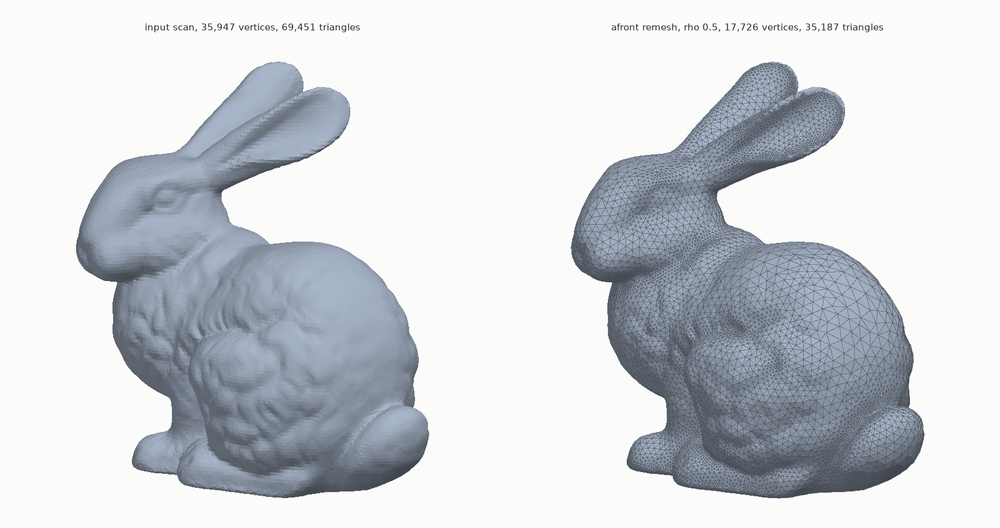
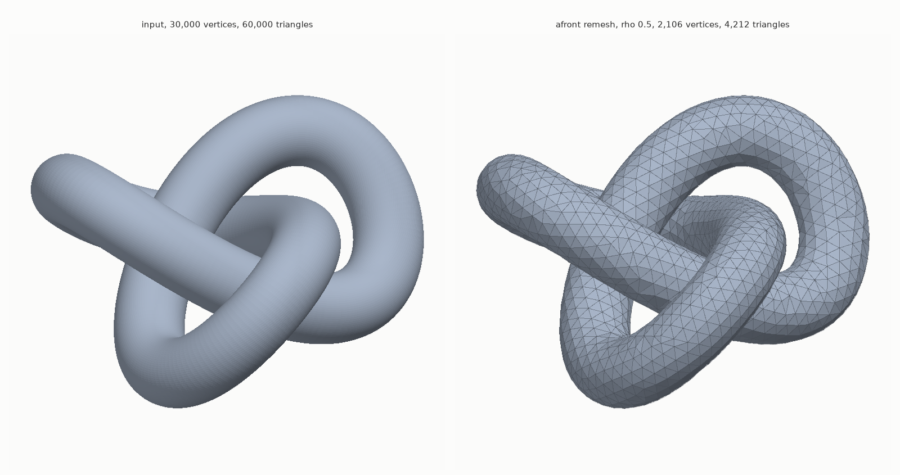
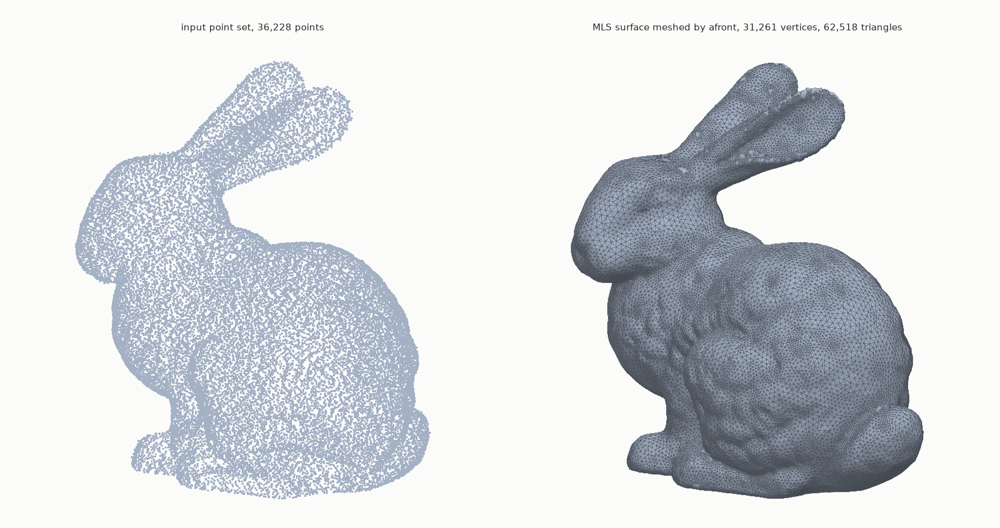
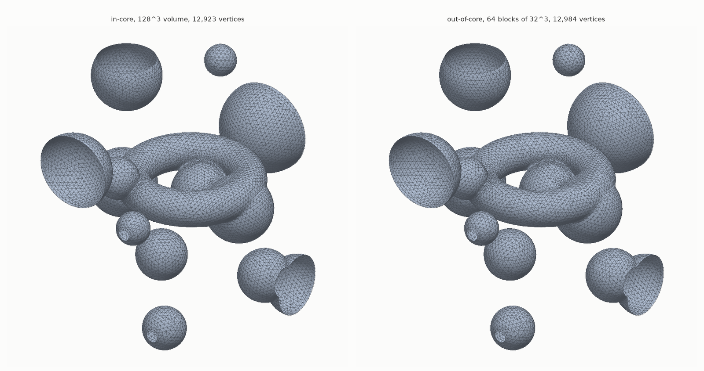
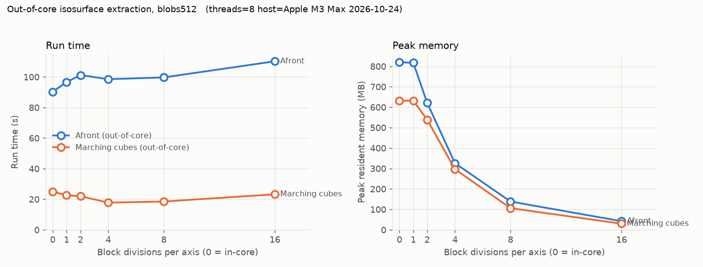

# Afront - Advancing Front Triangulation

**High-quality adaptive surface meshing and remeshing**

## Project History

Afront was developed in the mid-2000s and published at Eurographics and TVCG (see details below for the full papers). The code was released on SourceForge in January 2007 and John Schreiner kept developing it there until March 2009 for his dissertation: interval-arithmetic bounds that make the guidance field provably sufficient, out-of-core isosurface extraction from bricked volumes, streaming mesh output and multimaterial extraction. This repository started in October 2025 from the January 2007 internal CVS tree, patched to build on macOS. In October 2026 the full 2009 SourceForge tree was recovered (see `~/src/afront-2009-cvs` and [FOLD_NOTES.md](FOLD_NOTES.md)) and folded in; the current sources are that 2009 code plus the macOS fixes. The code uses lots of legacy things, including ancient OpenGL, GLUT, etc.

## Build Status

✅ **Successfully compiled and running on macOS (Apple Silicon ARM64)**
- Platform: macOS Darwin 27.2.0 (first built on 25.0.0)
- Compiler: Apple Clang 21 (first built with 17)
- Architecture: ARM64
- GUI mode: ✅ Functional (GLUT on the main thread, re-ported onto the 2009 viewer)
- Batch mode (`-nogui`): ✅ Functional, AddressSanitizer-clean on the tested paths
- Tested (October 2026, 2009 code): mesh remeshing (`data/bunny.off`, 2.5 s), point-cloud
  reconstruction (`data/bunny-points-with-normals.obj`, closed genus-0 result), isosurface
  extraction in-core and out-of-core on synthetic 64^3 to 512^3 volumes (correct topology,
  identical component sets in-core vs bricked)

⚠️ **Important Caveats**
- This 20-year-old codebase has been patched to compile on current systems, but **not all functionality has been tested**: CSG, tetrahedral meshes, multimaterial extraction and the feature-line (.flf) path have not been exercised since the fold
- Some features may not work due to legacy library incompatibilities (ancient OpenGL, Numerical Recipes routines, etc.)
- Seeding fails ("couldn't project seed point") when ideal edge lengths exceed about two voxels; use `-max_step` on coarse volumes
- Use with caution and expect issues with untested workflows

See [CLAUDE.md](CLAUDE.md) for detailed compilation fixes and performance characteristics.

## About Afront

Afront is an advancing front triangulation algorithm that can be applied to many different meshing scenarios. It makes use of a guidance field to determine triangle sizing that is adaptive to the curvature of the input surface, but also maintains smooth gradation to prevent poor quality triangles from being created. The prototype implementation can be used to generate meshes from other meshes (remeshing), from volumes defined on regular and irregular grids (isosurface extraction), and from point sets. It can be used to mesh either the entire input surface or just a local region, and can preserve sharp features that are annotated ahead of time.

**Main applications:**
- **Remeshing:** Improve existing triangle meshes with curvature-adaptive sizing
- **Isosurface extraction:** Extract surfaces from volumetric data (regular/irregular grids, tetrahedral meshes)
- **Point cloud reconstruction:** Generate meshes from point sets using Moving Least Squares (MLS) surfaces
- **CSG operations:** Boolean operations (union, intersection, subtraction) on meshes
- **Local region meshing:** Generate meshes for specific surface regions
- **Sharp feature preservation:** Maintains annotated creases and corners

**Developed by:** Visualization and Geometric Computing (VGC) group, University of Utah

---

## Gallery

All images below were produced with the current build (October 2026, Apple M3 Max, 8
threads) and rendered with [`tools/render_mesh.py`](tools/render_mesh.py), a small numpy
z-buffer renderer that reads afront's `.m` output, `.off` meshes and `.obj` point sets.

**Remeshing.** The scanned Stanford bunny (`data/bunny.off`) remeshed with
`./afront -nogui data/bunny.off -rho 0.5 -tri`. The output has half the triangles, graded by
curvature: small on the ears and face, large on the back. 2.5 s.



**Remeshing a dense, over-sampled surface.** `data/knot-300-100.off`, a 60,000-triangle
torus knot, remeshed at `-rho 0.5` to 4,212 well-shaped triangles. 1.3 s.



**Point-set surfaces.** `data/bunny-points-with-normals.obj` (36,228 points with normals)
meshed through the moving-least-squares projection:
`./afront -nogui data/bunny-points-with-normals.obj -rho 0.5 -tri_mls`. The result is a
closed genus-0 surface. 6.8 s.



**Isosurfaces, in-core and out-of-core.** A synthetic 128^3 volume (a torus, ten spheres
and three blobs cut by the volume boundary) extracted in-core and from the same volume
bricked into 64 blocks of 32^3 with `-save_ooc`. The two meshes have the same ten components
with matching sizes; the block boundaries leave no seams.



**Why out-of-core.** The dissertation's block-size experiment (`scripts/blocksize_test.sh`)
rerun on a synthetic 512^3 volume: peak memory follows the block size while run time grows
slowly with the number of blocks. In-core extraction peaks at 820 MB; 32^3 blocks at 42 MB
for a 20% longer run. Marching cubes on the same bricked field is shown for comparison.



---

## Features

### Core Capabilities
- ✅ **Curvature-adaptive triangle sizing** - Automatically adjusts triangle size based on local surface curvature
- ✅ **Multiple input formats** - Triangle meshes (.m, .off, .obj), volumes (.vol, .nhdr), tetrahedral meshes (.offt), point clouds (.pc, .obj)
- ✅ **Sharp feature preservation** - Detects and maintains creases and corners in the output mesh
- ✅ **CSG boolean operations** - Union, intersection, and subtraction of meshes
- ✅ **Interactive GUI** - OpenGL-based visualization for debugging and inspection
- ✅ **Multi-threaded** - Parallel surface projection for performance
- ✅ **Out-of-core isosurface extraction** - Volumes bricked into blocks (`-save_ooc`, `.nooc`) are meshed block by block in Z-order with a per-block guidance field; peak memory follows the block size, not the volume size
- ✅ **Certified guidance field** - Interval arithmetic (`interval.h`, `spline.h`) bounds the curvature of the tensor-product B-spline field, so the sampled guidance field is sufficient rather than heuristic
- ✅ **Streaming output** - `.sma/.smb/.smc/.smd(.gz)` streaming meshes (Isenburg's format, `lib/sm`), viewable with `sm_viewer`
- ✅ **Multimaterial extraction** - `-multi_material` for label volumes (untested since the fold)

### Algorithm Highlights
- **Priority-based front propagation** - Uses a heap to process edges in optimal order
- **Fence-based intersection prevention** - Prevents fronts from crossing each other
- **KD-tree spatial indexing** - Efficient nearest-neighbor queries
- **Failsafe triangulation** - Closes remaining holes when normal operations stall
- **Smooth gradation** - Prevents sudden changes in triangle size

---

## Building from Source

### Prerequisites

**macOS:**
```bash
# Install Xcode Command Line Tools
xcode-select --install

# Install dependencies via Homebrew
brew install cmake
brew install --cask xquartz  # X11 for GUI support
brew install freeglut
brew install libtiff

# IMPORTANT: After installing XQuartz, logout and login (or restart)
```

**Linux:**
```bash
# Debian/Ubuntu
sudo apt-get install build-essential cmake
sudo apt-get install libx11-dev libgl1-mesa-dev libglu1-mesa-dev freeglut3-dev
sudo apt-get install libtiff-dev zlib1g-dev

# Fedora/RHEL
sudo dnf install gcc-c++ cmake
sudo dnf install libX11-devel mesa-libGL-devel mesa-libGLU-devel freeglut-devel
sudo dnf install libtiff-devel zlib-devel
```

### Compilation

```bash
# Clone or download the source code
cd afront

# Create build directory
mkdir build && cd build

# Configure with CMake
cmake .. -DCMAKE_BUILD_TYPE=Release

# Build (use -j for parallel compilation)
make -j8

# Binary will be created at: build/afront
```

### Verification

```bash
# Check the binary
./afront --help  # Should display usage information
file ./afront    # Should show: Mach-O 64-bit executable (macOS) or ELF 64-bit (Linux)
```

---

## Usage

### Command Line Format

```bash
./afront <-nogui> <-noedgeflip> surface1 <mesh2> [-commands]
```

**Special options** (must be specified first):
- `-nogui` - Run afront in batch mode
- `-noedgeflip` - Bypass the streaming edge flipper (enabled by default for quality improvement)

**Note:** Commands are evaluated in the order they are specified, so set variables before invoking triangulation. The `-tri` command should usually be last.

### Quick Examples

**Remeshing:**
```bash
./afront bunny.off -rho 0.5 -tri
```

**Isosurface Extraction:**
```bash
./afront skull.nhdr -rho 0.8 -tri 150.5 bspline
```

### Input File Formats

| Format | Extension | Type | Description |
|--------|-----------|------|-------------|
| Triangle Mesh | `.m`, `.off` | Mesh | Input mesh for remeshing or CSG |
| Point Cloud | `.obj`, `.pc` | Points | Point set for MLS reconstruction |
| Volume | `.vol`, `.nhdr` | Regular grid | 3D scalar field for isosurface extraction |
| Bricked volume | `.nooc` | Out-of-core grid | Written by `-save_ooc`; a `.blocks/` directory next to it holds the bricks |
| Streaming mesh | `.sma` | Mesh | Isenburg streaming mesh (read in-core by gtb) |
| Tetrahedral Mesh | `.offt` | Irregular grid | Tetrahedral mesh (renamed from .off for distinction) |
| Feature Lines | `.flf` | Constraints | Sharp features for constrained triangulation |
| Second Mesh | mesh2 | Mesh | Optional second triangle mesh for CSG operations |

---

## Examples

### 1. Remesh an Existing Triangle Mesh

Improve mesh quality with curvature-adaptive sizing:

```bash
./afront input.m -tri_mesh -outname output.m
```

**With sharp feature detection (45° threshold):**
```bash
./afront input.m -sharp -0.707 -tri_mesh -outname output.m
```

**With Loop subdivision for better curvature estimation:**
```bash
./afront input.m -tri_mesh 2 -outname output.m  # 2 = subdivision level
```

### 2. Reconstruct Surface from Point Cloud

Using Moving Least Squares (MLS) surface:

```bash
./afront points.obj -tri_smoothmls -outname surface.m
```

**With feature line constraints:**
```bash
./afront points.obj features.flf -tri_smoothmls -outname surface.m
```

### 3. Extract Isosurface from Volume

Extract the zero-level isosurface:

```bash
./afront volume.vol -tri_vol 0.0 -outname surface.m
```

**With B-spline smoothing:**
```bash
./afront volume.vol -tri_vol 0.0 bspline -outname surface.m
```

### 4. Boolean Operations (CSG)

**Union:**
```bash
./afront mesh1.m mesh2.m -csg union -outname result.m
```

**Intersection:**
```bash
./afront mesh1.m mesh2.m -csg int -outname result.m
```

**Subtraction:**
```bash
./afront mesh1.m mesh2.m -csg sub -outname result.m
```

### 5. Run Without GUI

For batch processing or server environments:

```bash
./afront -nogui input.m -tri_mesh -outname output.m
```

---

### 6. Out-of-Core Isosurface Extraction

Brick the volume once, then extract from the bricked copy. Peak memory follows the block
size: on a synthetic 512^3 volume, in-core extraction peaks at 820 MB and 32^3 blocks at 42 MB,
for a 20% longer run.

```bash
# write vol.nooc and vol.blocks/ with 64^3 bricks (the six zeros are unused options)
./afront -nogui ./volume.nhdr -save_ooc ./ooc vol 64 64 64 0 0 0 0 0 0 1

# extract from the bricks; output streams to a .smb so it never has to fit in memory
cd ooc && ../afront -nogui ./vol.nooc -rho 0.5 -outname out.smb -tri 150.5 bspline
```

`-reuse_guidance 1` reuses the per-block guidance field written to `oocgf/` on a second
run with a different isovalue sampling. `scripts/blocksize_test.sh` and `scripts/volsize_test.sh`
are the dissertation's block-size and volume-size experiments.

## Parameters

### Triangle Sizing Control

| Parameter | Description | Default | Example |
|-----------|-------------|---------|---------|
| `rho <value>` | Angle subtended on osculating sphere (controls triangle size) | - | `rho 0.3` |
| `rho_N <N>` | Set rho based on N edges per circle | - | `rho_N 20` |
| `min_step <value>` | Minimum edge length | - | `min_step 0.001` |
| `max_step <value>` | Maximum edge length | - | `max_step 0.1` |
| `reduction <value>` | Size reduction per step (0-1) | 0.8 | `reduction 0.9` |

**How rho works:** Smaller values → smaller triangles (more detail)
**Typical values:** 0.1 (very fine) to 1.0 (coarse)

### Feature Detection

| Parameter | Description | Default | Example |
|-----------|-------------|---------|---------|
| `sharp <angle>` | Cosine of angle for sharp features | -2.0 (off) | `sharp -0.707` (45°) |

**Common angles:**
- `sharp -0.707` → 45 degrees
- `sharp -0.866` → 30 degrees
- `sharp 0.0` → 90 degrees

### MLS Surface Parameters

| Parameter | Description | Default | Example |
|-----------|-------------|---------|---------|
| `radius_factor <value>` | MLS radius scaling | 2.0 | `radius_factor 3.0` |
| `adamson <mode>` | MLS projection mode (0-3) | 0 | `adamson 1` |

### Output Control

| Parameter | Description | Default | Example |
|-----------|-------------|---------|---------|
| `outname <file>` | Output filename | `outmesh.m` | `outname result.m` |
| `failsafe <bool>` | Close holes that fail triangulation | true | `failsafe false` |

### Other Options

| Option | Description |
|--------|-------------|
| `-nogui` | Run without graphical interface |
| `gui` | Start GUI mode |
| `meshinfo` | Display mesh statistics |
| `flip` | Flip mesh orientation |
| `subdiv <N>` | Apply N Loop subdivisions |

---

## Complete Command-Line Options Reference

| Option | Parameters | Description |
|--------|------------|-------------|
| `-nogui` | - | Run afront in batch mode without GUI |
| `-noedgeflip` | - | Bypass streaming edge flipper (enabled by default) |
| `-tri` | - | Triangulate entire input mesh |
| `-tri_mesh` | `[subdiv]` | Triangulate mesh (optional Loop subdivision level) |
| `-tri_vol` | `<isovalue> [bspline]` | Extract isosurface from volume |
| `-tri_tet` | `<isovalue>` | Extract isosurface from tetrahedral mesh |
| `-tri_mls` | - | Triangulate MLS surface from points (was `-tri_smoothmls` in the 2007 tree) |
| `-tri_region` | `<point>` | Triangulate region around specified point |
| `-csg` | `union\|int\|sub [subdiv]` | Boolean operation on two meshes |
| `-sharp` | `<cos_angle>` | Sharp feature detection threshold |
| `-rho` | `<value>` | Triangle sizing angle (0.2-0.8 typical) |
| `-rho_N` | `<edges>` | Set rho based on N edges per circle |
| `-min_step` | `<length>` | Minimum edge length |
| `-max_step` | `<length>` | Maximum edge length |
| `-reduction` | `<factor>` | Size reduction rate (0.7-0.85 typical) |
| `-radius_factor` | `<value>` | MLS radius scaling factor |
| `-adamson` | `<0-3>` | MLS projection mode |
| `-outname` | `<filename>` | Output mesh filename |
| `-failsafe` | `<0\|1>` | Enable/disable failsafe hole closing |
| `-gui` | - | Enable GUI mode |
| `-meshinfo` | - | Display detailed mesh statistics |
| `-flip` | - | Flip mesh orientation |
| `-subdiv` | `<N>` | Apply N Loop subdivision iterations |
| `-save_ooc` | `<dir> <name> bx by bz 0 0 0 0 0 0 <sampling>` | Brick a volume into blocks of bx x by x bz voxels, writing `<dir>/<name>.nooc` |
| `-make_gf` | `<block> <isovalue> [bspline]` | Build the guidance field for one block (used by `scripts/gfdistrib.py`) |
| `-reuse_guidance` / `-reuse_seeds` | `<0\|1>` | Reuse the per-block guidance field / seeds saved in `oocgf/` |
| `-prefetch_rings`, `-prefetch_lookahead`, `-max_grab_bag` | `<N>` | Out-of-core block cache control |
| `-value_tol`, `-step_tol`, `-max_iter` | `<v>` | Projection convergence (defaults 1e-8, 1e-4, 50) |
| `-noedgeflip` | `<0\|1>` | Also available as a variable |
| `-multi_material` | `[bspline]` | Multimaterial extraction from a label volume |
| `-vol_smooth` | - | Smooth a volume (was `-volsmooth`) |

Removed since the 2007 tree: `-load_field`, `-save_field`, `-save_vol`, `-reeb`, `-reeb_eps`,
`-proj_tol`, `-saliency`. Run `./afront -nogui x` to print the full list.

---

## GUI Keyboard Controls

When running with the GUI enabled, the following keyboard shortcuts are available:

### Triangulation Control

| Key | Action |
|-----|--------|
| `p` / `P` | Toggle pause/unpause triangulation (WaitForUser mode) |
| `Spacebar` | Single-step triangulation when paused (triggers redraw) |

### Display Toggles

| Key | Action |
|-----|--------|
| `m` / `M` | Cycle mesh drawing mode (0→1→2) |
| `o` / `O` | Cycle output drawing mode (0→1→2) |
| `b` / `B` | Toggle boundaries display |
| `n` / `N` | Toggle normals display |
| `g` / `G` | Toggle guidance field visualization |
| `f` / `F` | Toggle front display |
| `e` / `E` | Toggle fence display |
| `+` | Increase point size |
| `-` | Decrease point size (minimum 1) |

### View Controls

| Key | Action |
|-----|--------|
| `a` / `A` | View all - reset camera to fit entire scene |
| `i` / `I` | Toggle immediate rendering mode |
| `2` | Toggle orthographic projection |

### Save/Load View

| Key | Action |
|-----|--------|
| `s` / `S` | Save current view to `view.txt` |
| `l` / `L` | Load view from `view.txt` |

### Debug

| Key | Action |
|-----|--------|
| `c` / `C` | Clear debug drawings |

### Help & Exit

| Key | Action |
|-----|--------|
| `?` / `h` / `H` | Show keyboard controls help in terminal |
| `q` / `Q` | Quit application |
| `ESC` | Quit application |

### Mouse Controls

| Action | Control |
|--------|---------|
| Rotate view | Left mouse button + drag |
| Zoom | Shift + Left mouse drag OR Ctrl + Left mouse drag |
| Pan view | Alt + Left mouse drag |

**Note:** Ctrl+Left mouse drag is especially useful on macOS with single-button trackpads.

### Mesh Editing Mode

When in mesh editing mode (activated via `UIEditMesh`):

| Key | Action |
|-----|--------|
| `b` / `B` | Exit mesh editing mode |
| `r` / `R` | Set to rotate mode |
| `t` / `T` | Set to translate mode |
| `s` / `S` | Set to scale mode |
| `x` / `X` | Transform along X-axis (lowercase=negative, uppercase=positive) |
| `y` / `Y` | Transform along Y-axis (lowercase=negative, uppercase=positive) |
| `z` / `Z` | Transform along Z-axis (lowercase=negative, uppercase=positive) |
| `+` / `=` / `F` | Increase edit factor (double it) |
| `-` / `_` / `f` | Decrease edit factor (halve it) |

---

## Complete Command Examples

### High-Quality Remeshing with Feature Preservation

```bash
./afront bunny.m \
  -rho 0.2 \
  -min_step 0.001 \
  -max_step 0.05 \
  -sharp -0.707 \
  -tri_mesh 1 \
  -outname bunny_remeshed.m
```

### Point Cloud to Mesh with Custom MLS Settings

```bash
./afront scan.pc \
  -radius_factor 2.5 \
  -adamson 1 \
  -rho_N 15 \
  -tri_smoothmls \
  -outname scan_surface.m
```

### Isosurface Extraction with Sizing Control

```bash
./afront ct_scan.vol \
  -tri_vol 128.0 \
  -rho 0.3 \
  -reduction 0.85 \
  -outname bone_surface.m
```

### Batch Processing (No GUI)

```bash
#!/bin/bash
for file in data/*.obj; do
  output="results/$(basename $file .obj).m"
  ./afront -nogui $file -tri_smoothmls -outname $output
done
```

---

## Output Formats

Afront can generate output in multiple formats through different output controllers:

- **`.m` format** - Standard mesh format (Meshview compatible)
- **`.obj` format** - Wavefront OBJ
- **`.sma` / `.smb` / `.smc` / `.smd` (optionally `.gz`)** - Isenburg streaming meshes, written
  as the front advances, so the output never has to fit in memory; `build/sm_viewer` displays them
- **HHM format** - Custom hierarchical mesh format

`.ply` is not supported; `-outname out.ply` exits with a message (convert with `convert_ply_to_off.py`).

Output controllers can be chained to produce multiple outputs simultaneously.

---

## Algorithm Overview

### How It Works

1. **Initialization**
   - Load input surface (mesh/volume/points)
   - Create guidance field from curvature or point spacing
   - Initialize active fronts from boundaries or seed points

2. **Front Propagation Loop**
   - Pop highest priority edge from heap
   - **GROW operation:** Attempt to create new vertex
     - Project tentative point onto surface
     - Check for intersections with existing fronts (fence test)
     - If legal, create new triangle and update fronts
   - **CONNECT operation:** If growth fails, connect to existing vertex
     - Find nearby vertices
     - Check legality and quality
     - Create triangle and merge/split fronts

3. **Termination**
   - Continue until all fronts are closed
   - Failsafe mode closes remaining small holes

### Key Data Structures

- **Priority Heap:** Orders front edges by quality/size metrics
- **KD-Tree:** Spatial indexing for efficient neighbor queries
- **Active Fronts:** Circular linked lists of vertices being triangulated
- **Guidance Field:** Spatially-varying ideal edge length field

---

## Troubleshooting

### Build Issues

**Error: `X11/Xlib.h` not found**
```bash
# Install XQuartz on macOS
brew install --cask xquartz
# Logout and login after installation
```

**Error: `tiffio.h` not found**
```bash
brew install libtiff  # macOS
sudo apt-get install libtiff-dev  # Linux
```

**Error: OpenGL deprecation warnings (macOS)**
- These are harmless - OpenGL still works despite macOS deprecation
- Warnings are silenced with `-DGL_SILENCE_DEPRECATION` flag

### Runtime Issues

**Crash on startup with GUI**
- Ensure XQuartz is installed and you've logged out/in
- Try running with `-nogui` flag

**Poor triangle quality**
- Decrease `rho` value for finer triangles
- Adjust `min_step` and `max_step` bounds
- Try increasing `reduction` factor

**Missing features in output**
- Use `-sharp` parameter to detect sharp edges
- Provide feature lines via `.flf` file
- Increase subdivision level for better curvature estimation

---

## Advanced Usage

### Custom Guidance Fields

The guidance field controls how triangle size varies across the surface. For meshes, it's computed from curvature. For point clouds, it's based on point spacing.

**Modify sizing:**
- `rho` controls the base relationship between curvature and size
- `reduction` controls how quickly size decreases in detailed regions
- `min_step`/`max_step` provide hard bounds

### CSG with Custom Sizing

```bash
# CSG with subdivision for better curvature
./afront mesh1.m mesh2.m -csg union 2 -rho 0.25 -outname result.m
```

### Debugging

Enable GUI to visualize fronts during triangulation:
```bash
./afront input.m -gui -tri_mesh
# Use keyboard to step through algorithm
```

---

## Technical Details

### Dependencies

**Core libraries:**
- **gtb** - Graphics toolbox (point/vector/matrix operations, KD-trees)
- **mlslib** - Moving Least Squares surface projection
- **sm** - Isenburg's streaming-mesh reader/writer (lib/sm, 2009)
- **ThreadLib** - Multi-threading support
- **viewer** - OpenGL visualization
- **rmlslib** - Robust MLS implementation (VGC-internal; builds, but afront is compiled with `NO_RMLS`)

**External dependencies:**
- OpenGL/GLU/GLUT - Graphics
- X11 - Windowing (via XQuartz on macOS)
- zlib - Compression
- pthreads - Threading

### Compilation Flags

The code is compiled with:
- `-DUSENR` - Use Numerical Recipes algorithms
- `-DREAL_IS_DOUBLE` - Use double precision (the 2009 multimaterial code does not compile as float)
- `-D_REENTRANT` - Thread-safe code
- `-Wno-c++11-narrowing` - Suppress modern C++ warnings

### Threading Model

- **Front propagation:** sequential for correctness (the main thread in `-nogui` mode, a worker thread in GUI mode)
- **Projector threads:** `idealNumThreads/2` threads project tentative vertices in parallel
- **Guidance field:** curvature sampling and trimming run on `idealNumThreads` threads
- **Main thread (GUI mode):** runs GLUT, as macOS requires

Default: 8 threads (`-idealNumThreads N` to change). On the bunny, 1 thread takes 8 s and 8 threads 2.5 s.

---

## Publications

Please cite the relevant papers when using our algorithm or code in your research.

### Primary Papers

**Direct (Re)Meshing for Efficient Surface Processing**
- John M. Schreiner, Carlos Eduardo Scheidegger, Shachar Fleishman, Cláudio T. Silva
- Computer Graphics Forum 25(3): 527-536 (2006)

```bibtex
@article{schreiner2006remeshing,
  title={Direct (Re)Meshing for Efficient Surface Processing},
  author={Schreiner, John M. and Scheidegger, Carlos Eduardo and Fleishman, Shachar and Silva, Cl{\'a}udio T.},
  journal={Computer Graphics Forum},
  volume={25},
  number={3},
  pages={527--536},
  year={2006}
}
```

**High-Quality Extraction of Isosurfaces from Regular and Irregular Grids**
- John M. Schreiner, Carlos Eduardo Scheidegger, Cláudio T. Silva
- IEEE Transactions on Visualization and Computer Graphics 12(5): 1205-1212 (2006)

```bibtex
@article{schreiner2006isosurfaces,
  title={High-Quality Extraction of Isosurfaces from Regular and Irregular Grids},
  author={Schreiner, John M. and Scheidegger, Carlos Eduardo and Silva, Cl{\'a}udio T.},
  journal={IEEE Transactions on Visualization and Computer Graphics},
  volume={12},
  number={5},
  pages={1205--1212},
  year={2006}
}
```

**Triangulating Point Set Surfaces with Bounded Error**
- Carlos Eduardo Scheidegger, Shachar Fleishman, Cláudio T. Silva
- Symposium on Geometry Processing 2005: 63-72

```bibtex
@inproceedings{scheidegger2005triangulating,
  title={Triangulating Point Set Surfaces with Bounded Error},
  author={Scheidegger, Carlos Eduardo and Fleishman, Shachar and Silva, Cl{\'a}udio T.},
  booktitle={Symposium on Geometry Processing},
  pages={63--72},
  year={2005}
}
```

### PhD Thesis

**Surface Modeling Using Curvature-Adaptive Advancing Front Triangulation**
- John M. Schreiner
- University of Utah, 2009
- [Full thesis PDF](https://www.sci.utah.edu/~csilva/papers/thesis/john-schreiner-thesis.pdf)

This thesis provides comprehensive coverage of the advancing front triangulation algorithm, including detailed explanations of the guidance field, front propagation, and applications to various meshing scenarios.

---

## People

This software was produced by members of the Visualization and Geometric Computing (VGC) group at the University of Utah.

**Main contributors to the algorithm:**
- **John Schreiner** - Algorithm development and implementation
- **Carlos E. Scheidegger** - Core algorithm design and development
- **Shachar Fleishman** - Point-set surface methods
- **Claudio T. Silva** - Project supervision and direction

---

## Funding

This work was partially supported by:
- DOE under the VIEWS program and the MICS office
- National Science Foundation (grants CCF-0401498, CCF-0528201, EIA-0323604, IIS-0513692, and OISE-0405402)
- Sandia National Laboratories
- Lawrence Livermore National Laboratory
- IBM Faculty Award
- University of Utah Seed Grant

---

## License

This software is released under the **GNU General Public License (GPL)**.

See individual source files for specific license headers and copyright information.

---

## Project Links

- **Homepage:** https://afront.sourceforge.net/
- **SourceForge:** https://sourceforge.net/projects/afront/
- **Original Institution:** University of Utah, Visualization and Geometric Computing Group

---

## Changelog

### 2009 code folded in (October 2026)

The SourceForge CVS repository (John Schreiner's commits 2007-01-09 to 2009-03-24) was
recovered and replaces the 2007 sources; see [FOLD_NOTES.md](FOLD_NOTES.md) and
[PLAN.md](PLAN.md). Highlights:

- Out-of-core isosurface extraction (`-save_ooc`, `.nooc`, per-block guidance fields,
  Z-order block traversal), interval-arithmetic guidance field bounds, streaming output,
  multimaterial extraction, `sm_viewer`, the dissertation's experiment scripts in `scripts/`.
- Four bugs fixed while reviving it: a dangling reference in the guidance-field trimmer, a
  front merge that inserted through the wrong list (crashes with libc++'s cached list size),
  an infinite loop when no seed can be projected, and a crash on unknown output extensions.
- Real type is now double. `-tri_smoothmls` is now `-tri_mls`.
- Same machine, `data/bunny.off`: 2.5 s instead of 21 s (the 2007 ThreadLib spent 42 s of
  system time in lock contention). The bunny point cloud now reconstructs; the 2007 build
  produced a degenerate 4-vertex mesh.
- The macOS GUI fix and the `[TIMING]` lines were re-applied on the 2009 code; the 2007 SVD
  tolerance patch was not (no convergence failures seen with double precision).

### Modernization for macOS Apple Silicon (October 2025, 2007 tree)

### Modernization for macOS Apple Silicon (October 2025)

The original codebase (circa 2005) has been successfully modernized to compile and run on:
- macOS Darwin 25.0.0 (Sequoia)
- Apple Silicon (ARM64) architecture
- Clang 17.0.0 compiler

**Major fixes applied:**
1. **CMake modernization** (3.10+ compatibility)
2. **macOS pthread compatibility** (`PTHREAD_MUTEX_RECURSIVE`)
3. **XQuartz/X11 integration** for GUI support
4. **Template specialization order** corrections
5. **C++11 standard compliance** fixes
6. **Dependent name lookup** in templates
7. **Platform-specific RNG functions** (drand48_r → drand48 on macOS)
8. **GLUT threading fix** for macOS (main thread requirement)
9. **SVD numerical stability** improvements (partial)
10. **VertexVertexIteratorI crash fix** (isolated vertices) - **CRITICAL**
11. **isfinite()** compatibility with modern C++
12. **getpid()** header inclusion

**Bug Fix (October 14, 2025):**
- Fixed critical heap-buffer-overflow in `VertexVertexIteratorI` constructor
- The bug caused crashes in batch mode (`-nogui`) when processing meshes with isolated vertices
- Detection: AddressSanitizer (`-fsanitize=address`)
- Fix location: `gtb/graphics/triangle_mesh.cpp:621-631`
- Impact: No-GUI mode now works correctly with any thread count

**Performance Analysis (October 14, 2025):**
- Identified threading limitations in mesh triangulation workloads
- Main bottleneck is single-threaded curvature computation (35K+ vertices sequential)
- Threading benefits primarily volume/isosurface operations, not mesh remeshing
- Recommendation: Use 1-2 threads for mesh operations to avoid unnecessary overhead

**Performance Logging Added (October 14, 2025):**
- Added comprehensive timing output with `[TIMING]` prefix
- Metrics include: verts/sec (curvature), tris/sec (triangulation), elapsed times
- Shows actual projector thread count and performance characteristics
- Example output:
  ```
  [TIMING] Computing curvature for 35947 vertices...
  [TIMING] Curvature computation completed in 2.59 seconds (13854 verts/sec)
  [TIMING] Trimming guidance field...
  [TIMING] Guidance field trimming completed in 0.20 seconds
  [TIMING] Starting triangulation (using 8 projector threads)...
  [TIMING] Triangulation completed in 12.99 seconds
  [TIMING] Generated 24134 triangles (1857 tris/sec)
  ```
- Confirmed performance benchmarks: ~14,000 verts/sec, ~1,900 tris/sec
- Guidance field trimming shows 4.7x speedup with 16 threads (0.94s → 0.20s)
- (With the 2009 code these numbers are ~100,000 verts/sec and ~19,000 tris/sec on the same bunny.)

The code maintains backwards compatibility with Linux while now supporting modern macOS.

---

## Contributing

This is a research prototype. For bug reports or questions, please use the SourceForge project page.

---

## Acknowledgments

Developed by the Visualization and Geometric Computing group at the University of Utah.

Special thanks to all contributors and funding organizations that made this research possible

---

**Last Updated:** October 2026
**Build Tested:** macOS 27.2 (ARM64), Apple clang 21
